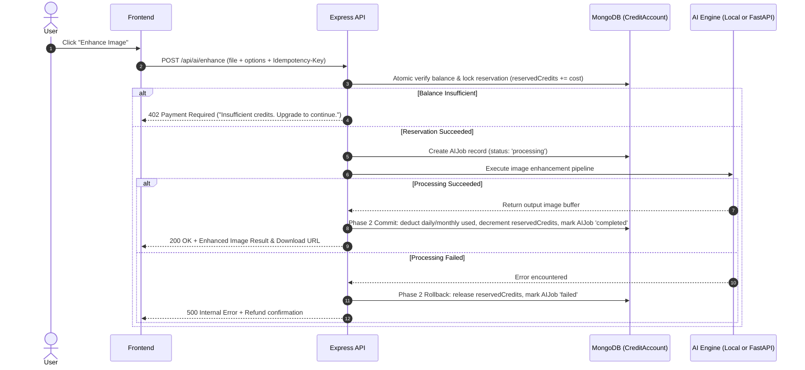

# ToolNest — Credit-Based AI Generation & Subscription System Documentation

This document describes the architecture, database models, payment abstractions, credit reservation lifecycle, and integration specifications for the ToolNest credit and subscription system.

---

## 1. System Architecture

ToolNest pairs a privacy-first, zero-tracking, browser-side utility platform with an authenticated, scalable credit engine for heavy AI workloads.

```
+-------------------------------------------------------------------------+
|                           ToolNest Frontend                             |
|  - 32 Browser-based local tools (PDF, Text, Images, Dev) - 100% Free   |
|  - AI Image Enhancer Tool (1 Credit / Operation)                        |
|  - Real-time Navigation Credit Indicator ("Free Plan: 3 / 3 Credits")   |
|  - User Dashboard & Usage History                                       |
|  - Pricing Page with Monthly/Annual toggle                              |
|  - Protected Admin Console                                              |
+-------------------------------------------------------------------------+
                                     |
                          REST API / JSON & JWT
                                     v
+-------------------------------------------------------------------------+
|                     ToolNest Backend (Express + TS)                     |
|  - Centralized Plans & Tool Cost Configuration                          |
|  - JWT Authentication (Access + Refresh Tokens + bcrypt 12 rounds)      |
|  - 2-Phase Atomic Credit Reservation Engine                             |
|  - Payment Provider Abstraction (Stripe, PayMongo, Sandbox)             |
|  - Webhook Idempotency & Signature Verification Ledger                  |
|  - AI Processing Pipeline & Temporary File Lifecycle Handler            |
+-------------------------------------------------------------------------+
          |                                            |
          v                                            v
+-----------------------+              +----------------------------------+
| MongoDB (Mongoose)    |              | Optional External AI Engine      |
|  - Users              |              | (Python + FastAPI Microservice)  |
|  - Subscriptions      |              |  - BiRefNet, Real-ESRGAN, etc.   |
|  - CreditAccounts     |              +----------------------------------+
|  - Transactions       |
|  - AIJobs             |
|  - Payments           |
|  - WebhookEvents      |
|  - AIToolConfigs      |
+-----------------------+
```

---

## 2. Subscription Plans & Credit Rules

| Plan        | Price (Configurable)       | Credits Allowance | Cadence                 | Priority | Processing Features                      |
| ----------- | -------------------------- | ----------------- | ----------------------- | -------- | ---------------------------------------- |
| **Free**    | \$0 / mo                   | 3 AI credits      | Daily reset (00:00 UTC) | Standard | Basic models, single generation          |
| **Pro**     | \$9.99 / mo or \$99 / yr   | 300 AI credits    | Monthly billing period  | Fast     | High-res enhancement, processing history |
| **Premium** | \$24.99 / mo or \$249 / yr | 1,000 AI credits  | Monthly billing period  | Highest  | Advanced models, batch, history          |

### Credit Rules:

1. **Free Daily Allowance:** 3 credits granted upon account creation and replenished every day at `00:00 UTC`.
2. **Device Clock Independence:** Reset calculation occurs strictly on the server by checking `dailyResetAt < currentUtcMidnight`. Client-side clock changes cannot force duplicate resets.
3. **No Indefinite Accumulation:** Daily free credits cap at 3 and do not accumulate if unused.
4. **Monthly Paid Credits:** Pro (300) and Premium (1,000) allowances renew with verified payment webhooks. Unused monthly credits expire at the end of each billing period.
5. **Offline Tools:** Standard offline tools (PDF mergers, JSON formatters, text counters, image converters) **never** consume credits and **never** require an account.

---

## 3. Two-Phase Atomic Credit Reservation

To prevent race conditions, double-spending, and credit loss during AI job failures, operations follow a 2-Phase atomic lifecycle:



### Concurrency Protection:

The reservation query utilizes atomic conditional updates (`$expr` and `$inc`):

```typescript
const updatedAccount = await CreditAccount.findOneAndUpdate(
  {
    userId,
    $expr: {
      $gte: [
        {
          $subtract: [
            {
              $add: [
                { $subtract: ['$dailyAllowance', '$dailyUsed'] },
                { $subtract: ['$monthlyAllowance', '$monthlyUsed'] },
              ],
            },
            '$reservedCredits',
          ],
        },
        cost,
      ],
    },
  },
  { $inc: { reservedCredits: cost } },
  { new: true },
);
```

If two requests arrive simultaneously with only 1 credit remaining, exactly one will match; the second receives `null` and is rejected with status 402.

---

## 4. Payment Provider Abstraction

ToolNest uses the `IPaymentProvider` interface:

```typescript
export interface IPaymentProvider {
  name: string;
  createCheckoutSession(params: CreateCheckoutParams): Promise<CheckoutSessionResult>;
  verifyWebhookSignature(rawBody: string | Buffer, signatureHeader: string): boolean;
  parseWebhookEvent(body: any): WebhookEventPayload | null;
  cancelSubscription(providerSubscriptionId: string): Promise<boolean>;
}
```

### Supported Providers:

1. **Stripe (`StripeProvider`):** Standard worldwide card checkout with HMAC-SHA256 signature verification (`t=...,v1=...`).
2. **PayMongo (`PayMongoProvider`):** Built for the Philippines and Southeast Asia. Supports GCash, Maya, GrabPay, and credit/debit cards with HMAC-SHA256 signature verification (`t=...,te=...,li=...`).
3. **Sandbox (`SandboxProvider`):** Enables full local development and testing without live credentials.

### Webhook Idempotency:

Every incoming webhook is logged in the `WebhookEvent` collection. Replayed event IDs are acknowledged with status 200 without executing duplicate credit grants or subscription activations.

---

## 5. API Endpoints Reference

### Authentication

- `POST /api/auth/register` — Creates user, Free subscription, and grants 3 daily credits.
- `POST /api/auth/login` — Returns JWT access token and sets HTTP-only refresh cookie.
- `POST /api/auth/logout` — Clears authentication cookie.
- `GET  /api/auth/me` — Returns current profile, subscription status, and credit balance.
- `POST /api/auth/refresh` — Generates a new access token using the refresh cookie.

### Credits

- `GET /api/credits/balance` — Detailed daily/monthly/reserved credit breakdown.
- `GET /api/credits/history` — Paginated ledger of all credit events (resets, consumptions, refunds).
- `GET /api/credits/usage` — 30-day breakdown of credits consumed by tool.

### Subscriptions & Payments

- `GET  /api/subscriptions/plans` — Centralized plan pricing, allowances, and features.
- `GET  /api/subscriptions/current` — Active subscription details and billing period end date.
- `POST /api/subscriptions/checkout` — Creates a real payment provider checkout session.
- `POST /api/subscriptions/cancel` — Cancels auto-renewal at period end.
- `POST /api/payments/webhook` — Verifies signatures and processes payment/subscription lifecycle events.

### AI Generation

- `POST /api/ai/enhance` — Upload image (`multipart/form-data`) with enhancement options. Reserves credit, executes AI processing, commits/refunds atomically.
- `GET  /api/ai/jobs/:jobId` — Job status and metadata inspection.
- `GET  /api/ai/history` — Recent AI jobs for authenticated user.
- `GET  /api/ai/download/:filename` — Secure download endpoint for processed images.

### Administration (Requires role: 'admin')

- `GET   /api/admin/users` — List registered users.
- `GET   /api/admin/subscriptions` — List active subscriptions.
- `GET   /api/admin/payments` — Payment ledger.
- `GET   /api/admin/usage` — System metrics (total jobs, credits consumed, failed jobs).
- `POST  /api/admin/credits/adjust` — Manual credit adjustment with mandatory audit reason.
- `GET   /api/admin/tools` — AI tools status and credit costs.
- `PATCH /api/admin/tools/:toolId` — Update tool credit cost or toggle tool on/off.

---

## 6. Local Development & Deployment

### Quick Start

1. Copy `.env.example` to `.env`:
   ```bash
   cp .env.example .env
   ```
2. Start MongoDB locally (or set `MONGODB_URI` to a MongoDB Atlas cluster).
3. Start the backend API:
   ```bash
   npm run dev:server
   ```
4. In a separate terminal, start the frontend Vite development server:
   ```bash
   npm run dev
   ```
5. Open `http://localhost:3000` in your browser.

Default Administrator Credentials:

- **Email:** `admin@toolnest.local`
- **Password:** `Admin123!Secure`
  _(Auto-seeded on first server startup)_
